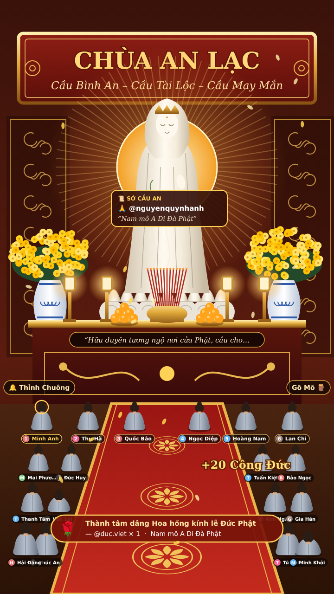

# Chùa Online Live

Overlay live "đi chùa online" tương tác, chạy cho **TikTok, YouTube và Facebook** cùng lúc nhưng độc lập với nhau.

- Mỗi người xem là một Phật tử có tên ngồi trong chánh điện. Top 6 người cúng dường ngồi hàng đầu.
- Bình luận hiện thành bong bóng lời nguyện và "Sớ cầu an". Gõ niệm Phật thì có tiếng mõ.
- Quà lớn được thỉnh chuông. Tim làm hoa rơi.
- **Giọng Thiện Đức (Vbee)** đọc tên và bình luận. Có bộ lọc từ tục, link, số điện thoại.



**Cài đặt và vận hành:** xem [HUONG-DAN.md](HUONG-DAN.md).
**Ghi chú cho lập trình:** xem [CLAUDE.md](CLAUDE.md).

```bash
npm install && cp config.example.json config.json && node server.js
# mở http://localhost:3000/tiktok  (mặc định chế độ demo)
```
